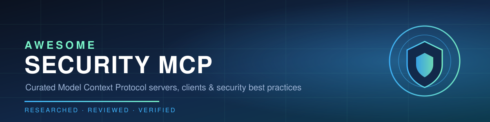

# Awesome Security MCP

**🔌 Official Servers • 🌐 Community Servers • 🛡️ Security MCP • 💻 Clients & Hosts • 🔐 Best Practices**

*Accuracy over coverage. Every entry is verified by reviewers before merging.*

---

## 📑 Contents

- [Contributing](#contributing)
- [Learning Resources](#learning-resources)
- [MCP Clients & Hosts](#mcp-clients--hosts)
- [MCP Security Best Practices](#mcp-security-best-practices)
- [Official MCP Servers](#official-mcp-servers)
- [Popular MCP Servers](#popular-mcp-servers)
- [Security-Specific MCP Servers](#security-specific-mcp-servers)

---

---

## Official MCP Servers

Servers maintained in the [modelcontextprotocol/servers](https://github.com/modelcontextprotocol/servers) repository.

- :star: [Everything](https://github.com/modelcontextprotocol/servers/tree/main/src/everything) - Reference/test server demonstrating prompts, resources and tools.
- :star: [Fetch](https://github.com/modelcontextprotocol/servers/tree/main/src/fetch) - Fetches web content and converts it for efficient LLM consumption.
- :star: [Filesystem](https://github.com/modelcontextprotocol/servers/tree/main/src/filesystem) - File operations restricted through configurable access controls.
- :star: [Git](https://github.com/modelcontextprotocol/servers/tree/main/src/git) - Reads, searches and manipulates Git repositories.
- :star: [Memory](https://github.com/modelcontextprotocol/servers/tree/main/src/memory) - Knowledge-graph-based persistent memory.
- :star: [Sequential Thinking](https://github.com/modelcontextprotocol/servers/tree/main/src/sequentialthinking) - Dynamic, reflective problem-solving through structured thought sequences.
- :star: [Time](https://github.com/modelcontextprotocol/servers/tree/main/src/time) - Time and timezone conversion tools.

**Archived reference servers** (in [servers-archived](https://github.com/modelcontextprotocol/servers-archived); no security updates or guarantees): GitHub, GitLab, PostgreSQL, SQLite, Puppeteer, Brave Search, Google Maps — see each vendor's maintained replacement in Popular MCP Servers below.

[🔝 Back to top](#awesome-security-mcp)

---

## Popular MCP Servers

Widely-used community and vendor MCP servers.

### Development, browser and local-system tools

- [Browser Use](https://github.com/browser-use/browser-use) - Browser Use's built-in CLI MCP server for web browsing.
- [browser-use-mcp-server](https://github.com/kontext-security/browser-use-mcp-server) - Independent Browser Use-based web-browsing integration.
- :star: [Chrome DevTools MCP](https://github.com/ChromeDevTools/chrome-devtools-mcp) - Chrome DevTools browser control, inspection, debugging, tracing and performance analysis.
- :star: [Context7](https://github.com/upstash/context7) - Upstash's current library documentation and code examples for agents.
- [Desktop Commander](https://github.com/wonderwhy-er/DesktopCommanderMCP) - Terminal control, filesystem search and diff-based file editing; inherently high privilege.
- :star: [Docker MCP Gateway](https://github.com/docker/mcp-gateway) - Docker's gateway and CLI for running and connecting catalogued MCP servers.
- [docker-mcp](https://github.com/QuantGeekDev/docker-mcp) - Independent Docker operations MCP server; avoid exposing an unrestricted Docker socket.
- [Filesystem Plus](https://github.com/smcneece/ClaudeDesktopFilesystemPlus) - Enhanced filesystem server with read-only directory support; distinct from the official reference server.
- :star: [GitHub MCP Server](https://github.com/github/github-mcp-server) - Official GitHub server for repos, code, issues, PRs, Actions, security alerts and workflows; selectable toolsets and read-only controls.
- :star: [GitLab MCP Server](https://docs.gitlab.com/user/model_context_protocol/mcp_server/) - GitLab-hosted access to projects, repositories, issues and merge requests.
- [Kubernetes MCP Server](https://github.com/containers/kubernetes-mcp-server) - Kubernetes and OpenShift resource inspection and management (Containers org, not Kubernetes itself).
- [mcp-server-commands](https://github.com/g0t4/mcp-server-commands) - Exposes process execution through a runProcess tool.
- [mcp-shell-server](https://github.com/tumf/mcp-shell-server) - Executes allowlisted shell commands with timeouts and structured audit logging.
- :star: [Playwright MCP](https://github.com/microsoft/playwright-mcp) - Microsoft-maintained browser automation using Playwright's accessibility tree.

### Cloud and infrastructure

- :star: [AWS MCP Servers](https://github.com/awslabs/mcp) - AWS Labs' collection of service-specific servers for AWS documentation, APIs, infrastructure and operations.
- :star: [Cloudflare MCP Servers](https://github.com/cloudflare/mcp-server-cloudflare) - Product-specific Cloudflare servers for platform configuration, data and developer services.
- :star: [Microsoft MCP catalog](https://github.com/microsoft/mcp) - Includes the Azure MCP Server and other Microsoft implementations for Azure resource and data operations.
- :star: [Supabase MCP](https://github.com/supabase/mcp) - Supabase project, database, development and debugging tools; prefer read-only, project-scoped operation.
- :star: [Terraform MCP Server](https://github.com/hashicorp/terraform-mcp-server) - HashiCorp's integration with the Terraform ecosystem and infrastructure-as-code workflows.
- [Vercel MCP](https://vercel.com/docs/agent-resources/vercel-mcp) - OAuth-enabled access to Vercel projects, deployments, logs, analytics and documentation (hosted).

### Observability

- [Elasticsearch MCP Server](https://github.com/elastic/mcp-server-elasticsearch) - Queries Elasticsearch indices and ES|QL; critical fixes only — use the Elastic Agent Builder MCP endpoint for Elastic 9.2+.
- :star: [Grafana MCP](https://github.com/grafana/mcp-grafana) - Searches dashboards and queries Grafana, Prometheus, Loki, alerting and related observability data.
- [Prometheus MCP Server](https://github.com/pab1it0/prometheus-mcp-server) - Executes and analyzes Prometheus/PromQL metric queries.
- [Sentry Toolkit / MCP](https://github.com/getsentry/toolkit) - Sentry issue, event, trace, release and debugging tools for coding agents.

### Databases

- :star: [MongoDB MCP Server](https://github.com/mongodb-js/mongodb-mcp-server) - Connects agents to MongoDB databases and MongoDB Atlas clusters.
- [MySQL MCP Server](https://github.com/designcomputer/mysql_mcp_server) - MySQL schema inspection and SQL interaction.
- [Postgres MCP Pro](https://github.com/crystaldba/postgres-mcp) - Configurable PostgreSQL access with schema, health and performance-analysis tools.
- :star: [Redis MCP](https://github.com/redis/mcp-redis) - Redis data management and search through natural-language agent workflows.
- [SQLite MCP](https://github.com/StacklokLabs/sqlite-mcp) - Lightweight SQLite MCP implementation; the old steering-group SQLite server is archived.

### Collaboration, productivity, identity and commerce

- :star: [Atlassian MCP Server](https://github.com/atlassian/atlassian-mcp-server) - Hosted access to Jira, Confluence, Jira Service Management, Bitbucket and Compass.
- [CLI for Microsoft 365 MCP](https://github.com/pnp/cli-microsoft365-mcp-server) - Exposes CLI for Microsoft 365 command discovery, documentation and execution (PnP).
- [Discord MCP](https://github.com/v-3/discordmcp) - Discord channel and messaging integration for MCP clients.
- [Google Workspace MCP](https://github.com/taylorwilsdon/google_workspace_mcp) - Self-hosted integration for Drive, Docs, Sheets, Slides, Gmail, Calendar, Chat, Forms and Tasks.
- [Linear MCP](https://linear.app/docs/mcp) - Finds, creates and updates Linear issues, projects and comments (hosted).
- [mcp-atlassian](https://github.com/sooperset/mcp-atlassian) - Jira and Confluence integration for self-hosted/Data Center needs.
- [Microsoft 365 MCP Server](https://github.com/Softeria/ms-365-mcp-server) - Graph API access to Microsoft 365 and Office services, with read-only and scope-selection options.
- [Microsoft MCP Server for Enterprise](https://learn.microsoft.com/en-us/graph/mcp-server/get-started) - Delegated, read-only Microsoft Graph access covering Entra users, groups, roles, directory data and security incidents.
- :star: [Notion MCP Server](https://github.com/makenotion/notion-mcp-server) - Notion workspace search, page/database access and editing through Notion's API.
- :star: [Okta MCP Server](https://github.com/okta/okta-mcp-server) - Okta-maintained self-hosted server for identity administration through Okta APIs.
- [Shopify MCP](https://github.com/GeLi2001/shopify-mcp) - Independent Shopify Admin API integration; distinct from Shopify's developer and storefront servers.
- [Shopify MCP options](https://shopify.dev/docs/apps/build/storefront-mcp/index) - Storefront/customer commerce MCP capabilities and a Dev MCP server for developer documentation and API assistance.
- [Slack MCP Server](https://docs.slack.dev/ai/slack-mcp-server) - Searches Slack, retrieves and sends messages, manages canvases and users, and uploads files (hosted).
- :star: [Stripe AI / Agent Toolkit](https://github.com/stripe/ai) - Stripe's agent tooling; the hosted Stripe MCP server exposes Stripe API operations and documentation search.
- [Teams MCP](https://github.com/floriscornel/teams-mcp) - Microsoft Teams and Graph API messaging, search and user operations (community, not Microsoft-maintained).
- [Work IQ MCP](https://learn.microsoft.com/en-us/microsoft-365/copilot/extensibility/work-iq/mcp/overview) - Microsoft-hosted Microsoft 365 intelligence across mail, calendar, files and Teams.

[🔝 Back to top](#awesome-security-mcp)

---

## Security-Specific MCP Servers

MCP servers for security operations, forensics, OSINT, threat intelligence and penetration testing.

### Reconnaissance, OSINT, vulnerability testing and reverse engineering

- [AbuseIPDB MCP](https://github.com/Salmanwz/mcp-abuseipdb) - Queries AbuseIPDB endpoints for IP reputation and abuse reports.
- :star: [Burp Suite MCP Server](https://github.com/PortSwigger/mcp-server) - PortSwigger's Burp extension connects AI clients to Burp through Streamable HTTP, legacy SSE or a stdio proxy, with approval controls.
- [Censys Platform MCP](https://docs.censys.com/docs/platform-mcp-server) - Censys-hosted Internet Map search, asset investigation, CVE research, query generation and attack-surface analysis.
- [GhidraMCP](https://github.com/LaurieWired/GhidraMCP) - Ghidra plugin and MCP bridge for reverse engineering, decompilation, symbols and program inspection.
- [Hashcat MCP](https://github.com/MorDavid/Hashcat-MCP) - Hashcat password-recovery automation through MCP.
- [John the Ripper MCP](https://github.com/schwarztim/sec-john-the-ripper-mcp) - :zzz: Archived SSH-to-Kali John the Ripper password-auditing wrapper.
- [MetasploitMCP](https://github.com/GH05TCREW/MetasploitMCP) - Controls Metasploit Framework operations through MCP (community).
- :star: [MISP MCP](https://github.com/MISP/misp-mcp) - MISP-owned, read-only event, attribute, object, tag, taxonomy, galaxy and feed search.
- [Nessus MCP Server](https://github.com/Cyreslab-AI/nessus-mcp-server) - Controls a Nessus instance through its REST API for vulnerability scanning and analysis (community).
- [Nmap MCP Server](https://github.com/imjdl/nmap-mcpserver) - Exposes Nmap network-scanning functionality through MCP (community).
- [Nuclei MCP](https://github.com/addcontent/nuclei-mcp) - Runs context-aware Nuclei vulnerability scans (community).
- [OpenCTI MCP Server](https://github.com/socfortress/opencti-mcp-server) - Read-only OpenCTI indicator and observable access; [mcp-opencti](https://github.com/jhuntinfosec/mcp-opencti) is another community implementation with broader threat-intelligence queries.
- [OpenVAS MCP](https://github.com/greenbone-hive/openvas-mcp) - Greenbone/OpenVAS target, task, scan, report and audit management through a Rust GVM API gateway (vendor-maintained).
- :star: [radare2-mcp](https://github.com/radareorg/radare2-mcp) - Radare2 organization's native stdio server for disassembly and binary analysis.
- [SecurityTrails MCP](https://github.com/pipeworx-io/mcp-securitytrails) - Thin SecurityTrails API wrapper (experimental community).
- [Shodan MCP Server](https://github.com/Cyreslab-AI/shodan-mcp-server) - Shodan host/network reconnaissance, InternetDB, CVE/exploit lookup and alerting (community).
- [SQLMap MCP](https://github.com/mohdhaji87/SQLMap-MCP) - Exposes SQLMap injection-testing and database-enumeration operations through FastMCP.
- [THC-Hydra MCP](https://github.com/schwarztim/sec-hydra-mcp) - :zzz: Archived SSH-to-Kali Hydra wrapper for authorized password testing.
- :star: [VirusTotal MCP](https://github.com/VirusTotal/virustotal-mcp) - Retrieves file, URL, domain and IP intelligence and supports explicitly requested submissions through VTAI, locally or through hosted OAuth.
- [Wireshark MCP](https://github.com/khuynh22/mcp-wireshark) - Uses Wireshark/tshark for live capture, PCAP parsing, display filters, stream following and JSON export.

### SIEM, detection, threat intelligence and DFIR

- [Arkime MCP](https://github.com/lflare/arkime-mcp) - Arkime session and network-investigation access.
- :new: [CAPE MCP](https://github.com/CAPESandbox/CAPE-mcp) - Small CAPESandbox-owned implementation for querying CAPE API v2 (experimental).
- :new: [CrowdStrike Falcon MCP](https://github.com/CrowdStrike/falcon-mcp) - Falcon detections, incidents, behaviors, threat intelligence and threat-hunting workflows (public preview).
- [Defender MCP](https://github.com/MenkW/Defender-MCP) - Microsoft Defender XDR incidents, alerts, machines, advanced hunting and threat intelligence (community).
- [Fleet MCP](https://github.com/fleetdm/fleet) - Fleet's endpoint-management platform includes MCP support for querying osquery data, host policies and vulnerabilities.
- [Malcolm MCP Server](https://github.com/nagameTW/mcp-server-malcolm) - Queries Malcolm's Zeek, Suricata, Arkime and NetBox data, read-only unless writes are explicitly enabled.
- [Microsoft Sentinel MCP](https://learn.microsoft.com/en-us/azure/sentinel/datalake/sentinel-mcp-get-started) - Microsoft-hosted security tool collections for Sentinel data exploration, hunting, graph analysis and triage; availability varies by collection.
- [osqueryi-mcp](https://github.com/mdfranz/osqueryi-mcp) - Local Go stdio server exposing host osquery tables and queries.
- :star: [Sigma MCP Server](https://github.com/SigmaHQ/sigma-mcp-server) - SigmaHQ's server exposing pySigma functionality, including Sigma rule validation, to MCP clients.
- :star: [Splunk MCP Server](https://splunkbase.splunk.com/app/7931) - Splunk's supported app for SPL execution/generation and Splunk data exploration ([CiscoDevNet repository](https://github.com/CiscoDevNet/Splunk-MCP-Server-official)).
- [SuricataMCP](https://github.com/Medinios/SuricataMCP) - Suricata IDS/IPS alert and rule-related integration.
- [TheHive MCP Server](https://github.com/gbrigandi/mcp-server-thehive) - TheHive alert, case, observable and incident-response operations.
- [Velociraptor MCP Server](https://github.com/socfortress/velociraptor-mcp-server) - Velociraptor DFIR querying and investigation workflows.
- [Wazuh MCP Server](https://github.com/gbrigandi/mcp-server-wazuh) - Wazuh alert, agent, vulnerability and indexer/API access for security investigations.
- [Windows Memory Forensics MCP](https://github.com/0xhackerfren/Windows-Memory-Forensics-MCP) - Memory-dump analysis through Volatility 3, MemProcFS, CLR/SOS and YARA.
- [YaraFlux](https://github.com/lwsinclair/YaraFlux) - YARA file scanning, rule management and threat analysis (community; provenance should be re-verified).
- [Zeek MCP](https://github.com/Gabbo01/Zeek-MCP) - Zeek network-security monitoring and log-analysis integration.

### Multi-tool security projects

- [Kali Linux MCP images](https://github.com/vxcontrol/kali-linux-image/tree/master/mcp) - Containerized MCP wrappers for Nmap, Metasploit, Nuclei, SQLMap, Hydra, John and Hashcat.
- [OSINT MCP Server](https://github.com/badchars/osint-mcp-server) - Multi-source OSINT covering Shodan, VirusTotal, Censys, SecurityTrails, DNS, WHOIS, certificate transparency and BGP.
- [Tengu](https://github.com/rfunix/tengu) - Pentest MCP server integrating numerous tools including Nmap, Metasploit, SQLMap, Nuclei and Hydra.
- [Threat Intel Toolkit](https://github.com/scottycwilsono/threat-intel-toolkit) - Combines AbuseIPDB, VirusTotal and Shodan IP-enrichment workflows.

*Not verified for the main list:* a dedicated Cuckoo Sandbox MCP and Sardarmani/SnortMCP (no README/adoption evidence) — candidates only. No first-party implementations verified for Nmap, Wireshark, Metasploit, Shodan, SecurityTrails, AbuseIPDB, OpenCTI, Wazuh, TheHive, Nessus, Nuclei, SQLMap, Hydra, John, Hashcat, Ghidra, Zeek, Suricata, Snort or Arkime; community implementations are linked above.

[🔝 Back to top](#awesome-security-mcp)

---

## MCP Clients & Hosts

Applications that consume MCP servers.

- :star: [Claude Desktop / Claude connectors](https://support.claude.com/en/articles/11175166-get-started-with-custom-connectors-using-remote-mcp) - Supports remote MCP connectors and local desktop server configurations.
- :star: [Cline](https://docs.cline.bot/mcp/mcp-overview) - VS Code coding agent with custom MCP server and marketplace support.
- :star: [Cursor](https://cursor.com/docs/mcp) - Built-in MCP support for local and remote servers through project/user configuration and marketplace integrations.
- [Kimi Code](https://www.kimi.com/code/docs/en/kimi-code-cli/customization/mcp.html) - Supports stdio, Streamable HTTP and legacy HTTP+SSE, OAuth, project/user configuration, workspace trust and tool allow/block lists.
- [LibreChat](https://www.librechat.ai/docs/features/mcp) - Self-hosted chat/agent platform with configurable MCP servers, OAuth support and access controls.
- :star: [MCP Inspector](https://github.com/modelcontextprotocol/inspector) - Official deterministic testing/debugging UI and proxy for MCP servers (developer tool, not a general LLM host).
- [mcp-cli (PyPI)](https://pypi.org/project/mcp-cli/) - Interactive/command-line MCP testing; canonical source repository should be re-verified.
- :star: [Roo Code](https://docs.roocode.com/features/mcp/using-mcp-in-roo) - VS Code agent supporting configured MCP servers and granular auto-approval settings.
- :star: [VS Code Copilot](https://code.visualstudio.com/docs/agent-customization/mcp-servers) - Adds MCP tools and data to Copilot agent workflows, with server management and enterprise controls.
- [Windsurf Cascade](https://docs.windsurf.com/plugins/cascade/mcp) - Connects Cascade to local and remote MCP servers.
- [Zed](https://zed.dev/docs/ai/mcp) - Supports MCP context servers and extensions; current documentation specifically calls out Tools and Prompts.

[🔝 Back to top](#awesome-security-mcp)

---

## MCP Security Best Practices

Primary references: [MCP Security Best Practices](https://modelcontextprotocol.io/specification/latest/basic/security_best_practices), [MCP Authorization](https://modelcontextprotocol.io/specification/latest/basic/authorization), [MCP Transports](https://modelcontextprotocol.io/specification/latest/basic/transports), [OWASP MCP Security Cheat Sheet](https://cheatsheetseries.owasp.org/cheatsheets/MCP_Security_Cheat_Sheet.html), [Official MCP Registry](https://registry.modelcontextprotocol.io/) (a discovery mechanism, not a security certification).

1. **Treat tool metadata and results as untrusted input.** Tool descriptions, schemas, annotations, web pages, documents, issues, emails and returned data can carry indirect prompt injection. Cross-server tool shadowing and post-approval "rug pulls" are also risks. Filtering alone cannot establish safety; enforce authorization outside the model.
2. **Vet and pin servers and tool definitions.** Review source, publisher, exact install command, dependencies and tool schemas. Pin reviewed package versions and hashes, verify signatures where available, and re-review changed tool definitions. Do not equate registry presence or GitHub stars with trustworthiness.
3. **Default to least privilege and read-only operation.** Enable only required servers, toolsets and individual tools. Use read-only database roles, restricted OAuth scopes, project-scoped access, filesystem allowlists and narrowly scoped Kubernetes/cloud identities. Avoid wildcard auto-approval.
4. **Require risk-appropriate approval.** Show full arguments and require confirmation for writes, deletion, payments, credential changes, data sharing, command execution, scans, exploitation and other irreversible actions. Tool annotations such as readOnlyHint are hints, not enforcement.
5. **Handle secrets as credentials, not prompts.** Use OS credential stores or a secret manager, short-lived per-server tokens and minimal injected environment variables. Never place secrets in repositories, prompts, command arguments, URLs or logs. Rotate and revoke credentials independently for each server.
6. **Validate remote authorization correctly.** Use TLS and OAuth appropriately, validate token audience, and reject tokens not issued for the MCP server. Do not use token passthrough. Access tokens must not appear in URI query strings.
7. **Choose and harden the transport.** stdio avoids a listening network port but does not sandbox the child process; it inherits the permissions and environment granted by the host. For Streamable HTTP, require authentication where needed, validate Origin and Host, bind local services to loopback, and protect session/state handles. The old standalone HTTP+SSE transport is deprecated; Streamable HTTP may itself use SSE for streaming.
8. **Sandbox local servers.** Run third-party servers with a dedicated unprivileged identity and restricted filesystem, process and network access. Containers are useful only when configured securely; do not mount sensitive directories, host credentials or the Docker socket unnecessarily.
9. **Constrain network and data exfiltration paths.** Apply egress allowlists, SSRF protections, URL validation, redirect checks, private-address blocking, timeouts, rate limits and output-size limits. Pay particular attention when one agent has access to private data, untrusted content and an outbound communication tool simultaneously.
10. **Add controls specific to offensive-security servers.** Run them only in isolated, explicitly authorized environments; use target allowlists, non-root identities, read-only defaults where possible, bounded scans, approval gates and complete audit logs. Avoid wrappers that expose unrestricted shell commands or arbitrary scanner arguments.
11. **Log without creating another secret store.** Record actor, server, tool, arguments, result status and timestamp, while redacting credentials and sensitive content. Monitor new tools, definition changes, unusual call frequency and cross-server data flows.
12. **Warn about submissions and samples.** VirusTotal and similar services may share submitted files or URLs with partners or the security community. A hash lookup is not permission to upload the underlying file; require explicit authorization for submissions involving internal code, documents, personal data or credentials.

[🔝 Back to top](#awesome-security-mcp)

---

## Learning Resources

- 📘 [MCP Specification](https://modelcontextprotocol.io/specification) - Protocol details, transports, authorization and security best practices.
- 🧭 [MCP Governance & community](https://github.com/modelcontextprotocol) - Steering-group repositories and community discussions.
- 🧪 [MCP Inspector](https://github.com/modelcontextprotocol/inspector) - Official testing/debugging UI and proxy for MCP servers.
- 🛡️ [OWASP MCP Security Cheat Sheet](https://cheatsheetseries.owasp.org/cheatsheets/MCP_Security_Cheat_Sheet.html) - Concise security checklist for MCP deployments.
- 🗂️ [Official MCP Registry](https://registry.modelcontextprotocol.io/) - Server discovery (not a security certification).
- 📚 [Awesome MCP Servers (wong2)](https://github.com/wong2/awesome-mcp-servers) - Community-curated list of MCP servers (another good discovery source).
- 📚 [Punkpeye/awesome-mcp-servers](https://github.com/punkpeye/awesome-mcp-servers) - Large community list of MCP servers and clients.
- 📚 [MCP.so](https://mcp.so) - MCP server directory and ecosystem hub.

[🔝 Back to top](#awesome-security-mcp)

---

## Contributing

See [CONTRIBUTING.md](CONTRIBUTING.md). One server per PR, verified links, honest descriptions, alphabetical order.

**License:** [MIT](LICENSE) © 2026 Okan YILDIZ

[🔝 Back to top](#awesome-security-mcp)
